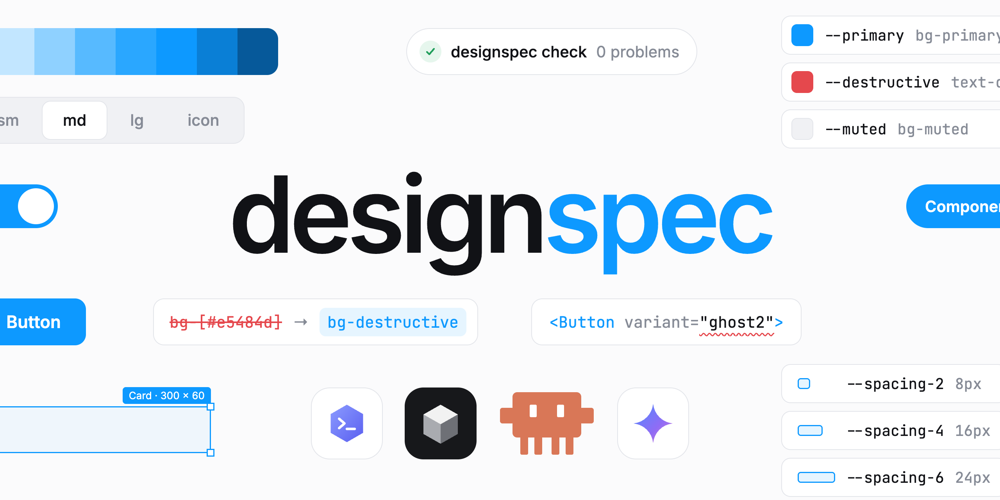

# designspec



**Keep AI-written UI on your design system.**

designspec reads your design system from code into a `design/` spec (tokens, component contracts, rules).
AI coding agents use that spec before they write UI, and a GitHub Action blocks pull requests that drift
from it.

```
$ npx designspec-kit init
✔ Next.js + Tailwind v4
✔ shadcn/ui (src/components/ui): 3 components, 18 variant values
✔ Headless: base-ui, radix (allowed only inside src/components/ui)
✔ 9 tokens from src/app/globals.css
✔ AI agents: AGENTS.md, skills designspec-ui + designspec-propose and an MCP server in .mcp.json
✔ Baseline: 12 existing violations recorded in design/baseline.json (they won't fail checks)
```

```
$ npx designspec-kit check --no-baseline

src/app/page.tsx
  9:22    error  Hardcoded color "text-[#1a1a1a]".  no-hardcoded-color
                 ↳ Closest token: text-foreground (--foreground).
  10:67   error  Raw palette color "bg-red-500".  no-palette-color
                 ↳ Closest token: bg-destructive.
  15:7    error  Native <button> used; the design system provides <Button>.  prefer-ds-component
                 ↳ import { Button } from "@/components/ui/button"
  16:24   error  "ghost2" is not a variant of Button.  no-unknown-variant
                 ↳ Allowed: default, destructive, outline, ghost, link. Need a new one? Run `designspec propose`.
  24:36   error  "h-12" overrides the height that Button's size variant controls.  no-variant-override
                 ↳ Pick a size instead (default, sm, lg, icon), or propose a new one with `designspec propose`.
```

## Why

AI agents write UI fast, but they don't know your design system. They hardcode hex values, invent
`variant="ghost2"`, resize a `<Button>` with classes and reach for `<button>`. Linters catch some of this.
Nothing tells the agent what to use instead, and nothing governs how the design system itself changes.

designspec does three things:

1. **Spec.** `design/` holds tokens ([W3C DTCG](https://www.designtokens.org/)), component contracts and rules. It is extracted from your code, so there is nothing to write by hand.
2. **Agents.** An `AGENTS.md` section, two skills and an MCP server make Claude Code, Cursor, Codex and others look things up in the spec and open a proposal instead of inventing values.
3. **Enforcement.** `designspec check` runs as a GitHub Action on your own runner, with no server and no API key. It only reports problems on changed lines, so adopting it doesn't mean fixing everything first.

## Supported stacks

| | |
| --- | --- |
| Frameworks | React, Next.js, Vite, Remix, React Native / Expo, Vue and Svelte single-file components |
| Styling | Tailwind CSS v4 and v3, CSS, SCSS and Less files, styled-components and Emotion (templates, object styles, `css` prop), inline styles, `StyleSheet.create`, MUI `sx` |
| Components | shadcn/ui and any `cva()` or tailwind-variants `tv()` components; others through string-literal union props (`variant?: "primary" \| "ghost"`); workspace UI packages (`@acme/ui`) and design systems from npm, read from their type declarations |
| Headless | Base UI, Radix |
| Component libraries | Chakra UI, Mantine, MUI: theme tokens (`createSystem`, `createTheme`) and style props (`bg="brand.500"`) |
| Tokens | CSS variables (incl. `.dark` and `[data-*]` theme modes, `@theme`, `@import`s), SCSS `$` and Less `@` variables, W3C DTCG and Tokens Studio JSON, Tailwind v3 config, JS/TS theme modules |

## Quick start

```bash
npm install --save-dev designspec-kit
npx designspec-kit init      # detect the stack, extract the spec, set up agents, record a baseline
npx designspec-kit check     # check the project
npx designspec-kit fix       # apply the fixes that are safe to apply automatically
```

Then add the GitHub Action (`.github/workflows/design-system.yml`):

```yaml
name: Design system
on: pull_request
permissions:
  contents: read
  pull-requests: write # for the PR comment
jobs:
  designspec:
    runs-on: ubuntu-latest
    steps:
      - uses: actions/checkout@v4
        with:
          fetch-depth: 0
      - uses: Eronred/designspec@v0
```

Problems show up as annotations on the PR diff, in the job summary and in a PR comment that is kept up to
date. Monorepos, AI review and the other inputs are covered in [docs/github-action.md](docs/github-action.md).

## Commands

| Command | What it does |
| --- | --- |
| `init` | Detect the stack, write `designspec.config.json`, extract `design/`, set up AI agents, record a baseline |
| `check [paths]` | Run the rules. `--diff <base>` reports only lines changed since `<base>` |
| `fix [paths]` | Visually identical rewrites: variant overrides → variants, token-equal colors → tokens, React Native numbers → `spacing.md` |
| `sync` | Update the spec from code |
| `explore` | Where code works around the design system: repeated overrides (missing variants) and values (missing tokens) |
| `preview` | One HTML page of every token (drawn, per mode) and component. `--diff <base>` marks what changed |
| `propose` · `apply` · `verify` · `archive` · `list` | Design system change proposals |
| `doctor` | What is checked in this project, what isn't, and why |
| `agents [--tools …]` | Set up AI agents: Claude Code, Cursor, Copilot, Gemini CLI, Windsurf |
| `mcp` | MCP server for AI agents |
| `review --diff <base>` | Optional AI review against `design/rules.md` (needs `ANTHROPIC_API_KEY`); suggestions only |
| `figma export-script` · `diff` · `push-script` | Compare Figma variables with the spec and sync them ([docs/figma.md](docs/figma.md)) |

All options: [docs/cli.md](docs/cli.md).

## The spec

```
design/
  tokens.json        # W3C DTCG tokens, with theme modes
  components/*.md    # contracts (frontmatter) + usage docs (body)
  rules.md           # design rules in plain language
  changes/           # open proposals
  archive/           # accepted proposals
  baseline.json      # violations that existed when designspec was adopted
```

A component contract, extracted from `cva()`:

```md
---
name: Button
source: src/components/ui/button.tsx
import: "@/components/ui/button"
exports: [ Button, buttonVariants ]
variants:
  Button:
    variant: [ default, destructive, outline, ghost, link ]
    size: [ default, sm, lg, icon ]
defaults:
  Button:
    variant: default
    size: default
controls:
  Button:
    size: [ height, padding, radius ]
replaces: [ button ]
---

# Button

Use for actions. Use `link` for navigation that looks like a button.
```

Code is the source of truth for values: `designspec sync` rewrites `tokens.json` and the frontmatter. The
body and `replaces` are yours and are kept. `controls` lists what each variant sets, so a `className`
that overrides it is reported (and `fix` turns it into the matching variant).

## Changing the design system

Changes to the design system go through a proposal: explore, propose, apply, verify, archive.

```bash
npx designspec-kit explore                          # where code works around the design system
npx designspec-kit propose panel-compact-padding    # design/changes/panel-compact-padding/{proposal,tasks}.md
# ...write the expected changes in the proposal's front matter, add padding="compact" to panel.tsx...
npx designspec-kit apply panel-compact-padding      # sync the spec, migrate overrides, verify
npx designspec-kit verify panel-compact-padding     # declared changes are in code, nothing else changed
npx designspec-kit archive panel-compact-padding    # once merged
```

`explore` starts with a design system adoption score (how much of the UI uses its components and color
tokens) and points at what's missing: on a real codebase it found `<Panel className="px-3 py-2">` written
100+ times, which became `padding="compact"`.

A proposal's front matter says what it changes, so `verify` can check the code did exactly that:

```yaml
---
tokens: { add: [--warning-strong] }
components: { add: [Toast] }
variants: { Panel.padding: { add: [compact] } }
---
```

On a pull request, the GitHub Action shows what changed in the design system: the PR comment lists
changed tokens with before/after color swatches and added or removed components and variants, and the
`designspec-preview` artifact is the full preview page with the changes marked.

A PR that changes the UI directory, the token sources or the spec without a proposal fails
`require-proposal`. Code and spec that disagree fail `spec-drift`.

## Rules

| Rule | Default | Catches |
| --- | --- | --- |
| `no-hardcoded-color` | error | `bg-[#e5484d]`, `style={{ color: "#333" }}`, `StyleSheet.create`, `fill="#000"`, `{ color: "#10b981" }`, CSS files |
| `no-palette-color` | error | `bg-red-500` and other Tailwind palette colors |
| `no-arbitrary-value` | warn | `p-[13px]`, `text-[15px]`, `rounded-[10px]`: utilities that have a scale |
| `no-raw-style-value` | warn | React Native: `padding: 16` instead of `spacing.md`, off-scale values |
| `prefer-ds-component` | error | `<button>`, `<input>`, React Native `TouchableOpacity`… when a component replaces them |
| `no-unknown-variant` | error | `<Button variant="ghost2">`, `buttonVariants({ size: "xl" })` |
| `no-variant-override` | error | `<Button className="h-12">`: classes overriding what a variant controls |
| `no-unknown-token` | warn | `var(--bordr)`: references to tokens nothing defines |
| `restricted-import` | error | Base UI / Radix outside the UI directory, or your own restrictions |
| `zone-tokens` | error | Marketing `landing-*` tokens in product UI, or any zone rule you define |
| `spec-drift` | error | Spec out of date with code |
| `require-proposal` | error | Design system changed without a proposal |

Existing problems are recorded in `design/baseline.json` when designspec is adopted and don't fail checks;
on a pull request only lines it adds are reported. For a deliberate exception, say why on the line:

```tsx
// designspec-ignore-next-line no-hardcoded-color: partner brand color
<span className="bg-[#ff6600]">Partner</span>
```

Every suggestion names the closest token or the right component. Details and options:
[docs/rules.md](docs/rules.md). Configuration: [docs/configuration.md](docs/configuration.md).

## AI agents

`init` sets up Claude Code, Cursor, GitHub Copilot, Gemini CLI and Windsurf (the ones the repo uses, or
`--tools`), and `AGENTS.md` for everything else. In a monorepo, tool files go to the git root, so they work
wherever the agent starts.

| What | Where | What it does |
| --- | --- | --- |
| Instructions | `AGENTS.md`, `.cursor/rules/`, `.github/copilot-instructions.md`, `GEMINI.md`, `.windsurf/rules/` | Where the spec is, what to use instead of hardcoded values, how to propose a change |
| Skills | `.claude/skills/` | `designspec-ui` (building UI), `designspec-propose` (changing the design system), `designspec-figma` (comparing with Figma) |
| MCP server | `.mcp.json`, `.cursor/mcp.json`, `.vscode/mcp.json`, `.gemini/settings.json` | Tools the agent calls while it works, and three prompts |

Agents pick the skills and tools up on their own when the task is UI work. You can also start them
yourself; in Claude Code, type `/`:

| Command | |
| --- | --- |
| `/designspec-ui` | Build or change UI with the design system's tokens and components |
| `/designspec-propose` | The design system lacks a token, variant or component: open a proposal instead of inventing one |
| `/designspec-figma` | Compare Figma variables with the code and sync them |
| `/mcp__designspec__check_changes` | Check the UI files changed in this session and fix what is found |
| `/mcp__designspec__propose` | Turn a need ("a warning color for quota alerts") into a proposal |
| `/mcp__designspec__apply` | Implement a proposal's tasks, then apply and verify it |

In a monorepo the MCP server is named after the app (`/mcp__designspec-web__check_changes`).

The MCP tools: `list_components`, `get_component`, `find_tokens` (also the closest token to a color),
`check_code` (the CI checks on code before it's saved), `get_rules`, `explore_design_system`,
`propose_change`, `verify_proposal`, `preview_design_system` and three Figma tools. Details:
[docs/ai-agents.md](docs/ai-agents.md).

### Teaching an agent designspec itself

The skills above work inside a project that uses designspec. To have an agent set designspec up, run its
commands or fix a failing check, install the `designspec` skill from [`skills/`](skills/designspec/SKILL.md):

```bash
/plugin install designspec --marketplace Eronred/designspec   # Claude Code
npx skills add Eronred/designspec                             # other agents
```

## Figma

Through the Figma MCP server, an agent compares Figma variables with the spec, per mode, and pushes code
values back as aliases where the code uses them. Ask it to "compare Figma with the code", or see
[docs/figma.md](docs/figma.md).

## Limitations

designspec reads code without running it. That keeps it fast and safe in CI, but some things it can't
check. It never passes them silently: `check` lists what it skipped, and `designspec doctor` shows
coverage per rule.

- Classes built at runtime (`` `bg-${color}-500` ``) or passed through props can't be checked.
- Values that depend on the platform or theme at runtime (`isAndroid ? 48 : 44`, `keyof typeof control.button`) are skipped when extracting tokens and variants.
- Angular and Astro templates, Panda CSS, vanilla-extract and StyleX aren't checked yet (`check` and `doctor` say so).
- On GitHub Free, private repositories can't make a check required, so a failing check can't block the merge by itself.

## Contributing

See [CONTRIBUTING.md](CONTRIBUTING.md).

## License

MIT
